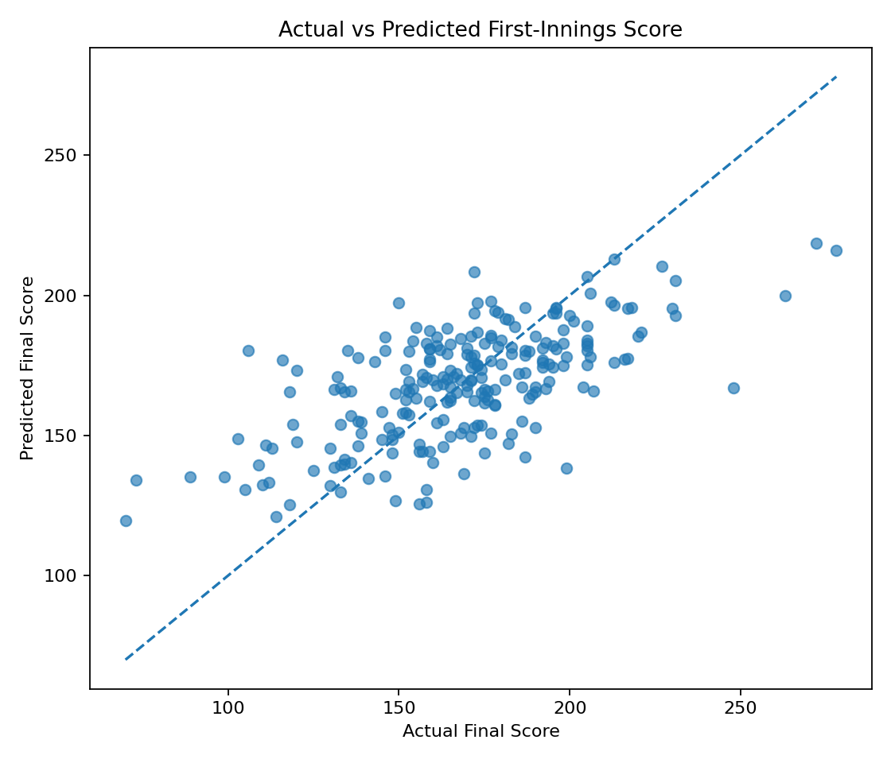
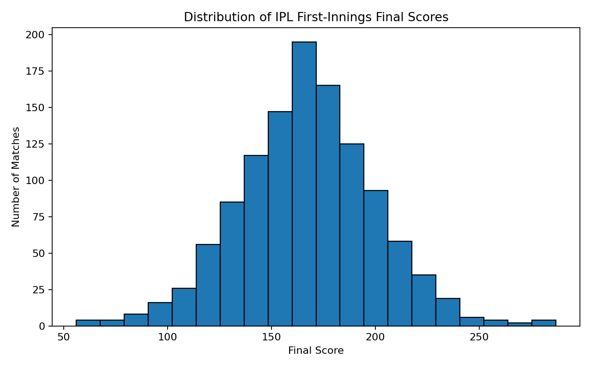
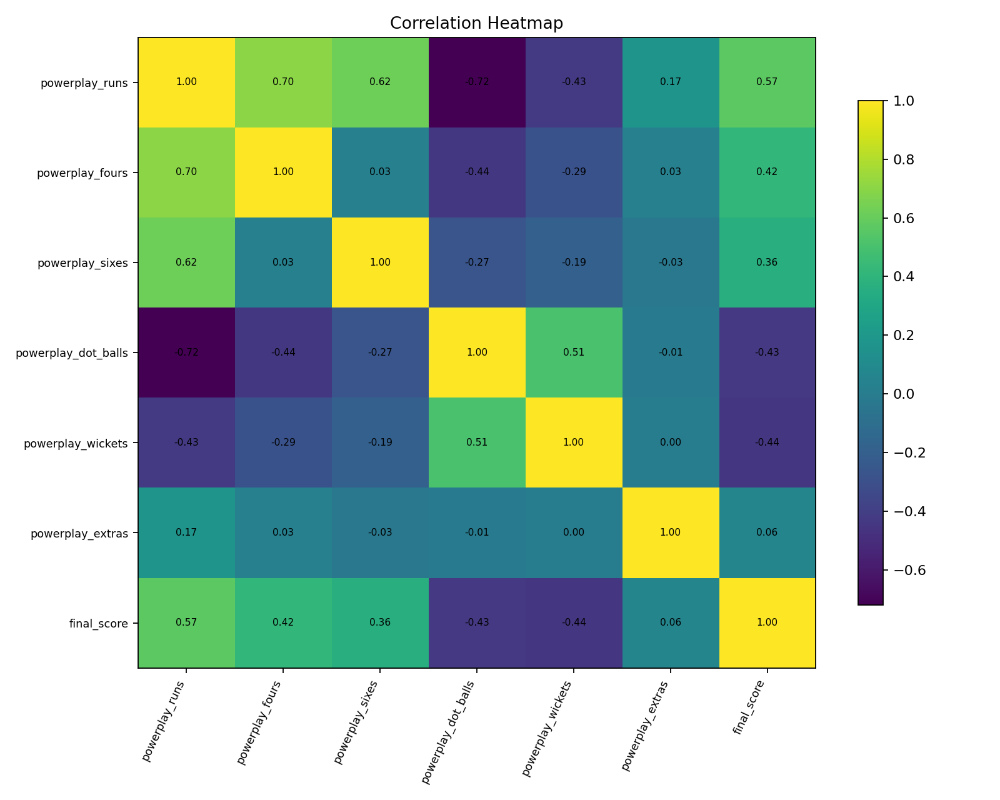

<div align="center">

# 🏏 IPL Score Intelligence

### **Powerplay → Prediction → Insight**

An interactive machine-learning command center that estimates an IPL team's **first-innings score from its first six overs**.

[](https://ipl-score-intelligence.streamlit.app)
[](https://github.com/SoumityaPandey/IPL-First-Innings-Score-Predictor)

**Built with Python · Pandas · NumPy · Scikit-learn · Plotly · Streamlit**

</div>

---

## ⚡ The idea in one line

> **Read the Powerplay, understand the momentum, estimate the innings.**

The app takes six match-level Powerplay signals — runs, fours, sixes, dot balls, wickets and extras — and feeds them into a trained **Linear Regression** model to estimate the final first-innings total.

This is not just a prediction script. It is a complete, interactive ML workflow wrapped inside a futuristic analytics dashboard.

---

## 🌐 Try it live

### 👉 [Open IPL Score Intelligence](https://ipl-score-intelligence.streamlit.app)

No installation required. Open the dashboard, move the Powerplay sliders, and watch the predicted score update instantly.

---

## 🖥️ What you can do inside the app

| Module | What it does |
|---|---|
| 🎛️ **Command Dashboard** | KPI overview, Powerplay signal, score distribution and feature cockpit |
| 🏏 **Score Predictor** | Live prediction using six interactive Powerplay controls |
| 🔎 **EDA Explorer** | Explore distributions, feature/score relationships and correlations |
| 🧪 **Model Evaluation** | Inspect MSE, RMSE, R², actual-vs-predicted values and residuals |
| 🗃️ **Data Explorer** | Filter processed matches by season, batting team and score range; export CSV |

### The prediction screen includes

- 🎚️ Six interactive Powerplay sliders
- 🎯 Live predicted first-innings score
- 📏 RMSE-based planning band
- 🕸️ Powerplay profile radar
- 📊 Feature contribution view
- ⚡ Conservative, Balanced and Aggressive scenario presets

> **Note:** The RMSE planning band is an error-based planning range, **not a statistical confidence interval**.

---

## 📊 Project at a glance

| | Value |
|---|---:|
| 🏏 IPL matches processed | **1,169** |
| 📦 Raw rows | **278,205** |
| 🧾 Raw columns | **64** |
| 🧠 ML model | **Linear Regression** |
| 🎯 Input features | **6** |
| 🏋️ Training samples | **935** |
| 🧪 Testing samples | **234** |
| 📉 RMSE | **23.84 runs** |
| 📐 R² | **0.427** |
| 📊 MSE | **568.55** |

### What the evaluation means

- **MSE = 568.55** — average squared prediction error on the prepared test split.
- **RMSE = 23.84 runs** — typical prediction error expressed in runs.
- **R² = 0.427** — the model explains about 42.7% of the variation in the target on the prepared test split.

The model is therefore best viewed as a **data-driven estimate**, not an exact score oracle.

---

## 🧠 Machine-learning pipeline

```mermaid
flowchart LR
    A[Raw IPL Ball-by-Ball Data] --> B[Data Cleaning]
    B --> C[Match-Level Aggregation]
    C --> D[Powerplay Feature Engineering]
    D --> E[EDA & Statistics]
    E --> F[Train/Test Split]
    F --> G[StandardScaler]
    G --> H[Linear Regression]
    H --> I[Evaluation]
    I --> J[Joblib Model + Scaler]
    J --> K[Streamlit Command Center]
```



### Target

**Final first-innings score**

### Six model inputs

| Feature | Meaning | Direction in cricket terms |
|---|---|---|
| `powerplay_runs` | Runs scored in the first six overs | More scoring momentum |
| `powerplay_fours` | Fours during the Powerplay | Boundary pressure |
| `powerplay_sixes` | Sixes during the Powerplay | High-impact scoring |
| `powerplay_dot_balls` | Dot balls during the Powerplay | Lower scoring pressure |
| `powerplay_wickets` | Wickets lost during the Powerplay | Early batting damage |
| `powerplay_extras` | Extras during the Powerplay | Additional runs |

The six inputs are standardized using **StandardScaler** before they reach the Linear Regression model.

---

## 🎨 Why the UI is different

Instead of presenting a traditional form like:

```text
Input → Predict → Number
```

the project turns the model into an **IPL analytics cockpit**.

### Visual language

- 🌌 Futuristic dark interface
- 💠 Cyan/violet analytics accents
- 🧩 KPI cards and information panels
- 📈 Interactive Plotly charts
- 🎛️ Real-time controls
- 🕸️ Radar-based Powerplay profile
- 📊 Model diagnostics
- 🗃️ Filterable match-level data

The goal is to make the machine-learning process **explorable**, not hidden behind a single prediction button.

---

## 📸 Analytics preview

### Powerplay signal



### Score distribution



### Feature relationships



> The live dashboard contains additional interactive versions of these analyses.

---

## 🔬 Model evaluation

The evaluation section of the app exposes the model rather than hiding it.

### Included diagnostics

- MSE
- RMSE
- R²
- Actual vs predicted scatter plot
- Residual distribution
- Training/testing sample summary

The trained model and scaler are stored as reusable `.joblib` artifacts so the deployed app can make predictions without retraining every time it starts.

---

## 🗂️ Repository structure

```text
IPL-First-Innings-Score-Predictor/
│
├── app.py                              # Streamlit application
├── ipl_ml_project.py                   # ML/data-processing pipeline
├── requirements.txt                    # Python dependencies
├── README.md                           # Project documentation
├── .gitignore                          # Git exclusions
│
├── ipl_project_output/
│   ├── IPL_ML_Processed.csv            # Processed match-level dataset
│   ├── descriptive_statistics.csv      # Descriptive statistics
│   ├── results.json                    # Saved model metrics/results
│   ├── linear_regression_model.joblib  # Trained Linear Regression model
│   ├── standard_scaler.joblib          # Fitted feature scaler
│   └── *.png                           # Analysis visualizations
│
└── docs/
    └── IPL_ML_Project_Report.pdf       # Project report
```

---

## 🛠️ Tech stack

### Data

- **Pandas** — data loading, cleaning and transformation
- **NumPy** — numerical operations

### Machine Learning

- **Scikit-learn** — train/test split, scaling, Linear Regression and evaluation
- **Joblib** — model and scaler persistence

### Visualization

- **Plotly** — interactive charts, gauge and radar visualizations
- **Matplotlib** — supporting analysis plots

### Application

- **Streamlit** — interactive web application

### Deployment

- **GitHub** — source control and repository hosting
- **Streamlit Community Cloud** — public deployment

---

## 💻 Run it locally

### 1. Clone

```bash
git clone https://github.com/SoumityaPandey/IPL-First-Innings-Score-Predictor.git
cd IPL-First-Innings-Score-Predictor
```

### 2. Create a Python 3.13 environment

Windows PowerShell:

```powershell
py -3.13 -m venv .venv
.venv\Scripts\Activate.ps1
```

### 3. Install dependencies

```bash
python -m pip install -r requirements.txt
```

### 4. Launch the dashboard

```bash
python -m streamlit run app.py
```

Open:

```text
http://localhost:8501
```

---

## 🚀 Deployment

This project is deployed from GitHub through **Streamlit Community Cloud**.

```text
GitHub repository
      ↓
main branch
      ↓
app.py
      ↓
requirements.txt
      ↓
Streamlit Community Cloud
      ↓
🌐 Public dashboard
```

### Current deployment

- **Repository:** [SoumityaPandey/IPL-First-Innings-Score-Predictor](https://github.com/SoumityaPandey/IPL-First-Innings-Score-Predictor)
- **Branch:** `main`
- **Entrypoint:** `app.py`
- **Live app:** [ipl-score-intelligence.streamlit.app](https://ipl-score-intelligence.streamlit.app)

To publish an update:

```bash
git add .
git commit -m "Update IPL Score Intelligence"
git push
```

---

## ⚠️ Limitations

This project intentionally keeps the ML approach simple and focused.

- Only **one model** is used: Linear Regression.
- Predictions use only **six Powerplay features**.
- No player-level information is included.
- No venue, pitch, toss, weather or match-condition variables are used by the model.
- The model does not account for changing team/player strength across seasons.
- RMSE is useful for understanding typical error, but it does not provide a formal prediction interval.
- The result should be interpreted as an analytical estimate rather than a guaranteed match score.

These limitations also define the natural next steps for a more advanced version.

---

## 🔮 Future roadmap

### Phase 1 — Stronger modelling

- [ ] Compare Linear Regression with Random Forest / Gradient Boosting
- [ ] Cross-validation
- [ ] Hyperparameter tuning
- [ ] Compare model error across seasons

### Phase 2 — Richer cricket intelligence

- [ ] Venue and pitch information
- [ ] Toss and innings context
- [ ] Team-strength features
- [ ] Player/batter-bowler information
- [ ] Recent-form features

### Phase 3 — Advanced product experience

- [ ] Live match-data integration
- [ ] Scenario comparison mode
- [ ] Historical team dashboards
- [ ] Explainable-AI layer
- [ ] Automated model monitoring

---

## 📄 Project report

The complete project report is available here:

**[`docs/IPL_ML_Project_Report.pdf`](docs/IPL_ML_Project_Report.pdf)**

---

## 🎓 Project takeaway

This project demonstrates the complete path from **raw cricket data to a usable machine-learning product**:

> **Clean → Engineer → Explore → Scale → Train → Evaluate → Visualize → Deploy**

The most important part is not simply predicting a number. It is showing how a trained model can be turned into an **interactive, understandable and deployable data-science application**.

---

<div align="center">

### 🏏 Explore the model. Move the Powerplay. Read the signal.

**[🚀 Launch IPL Score Intelligence](https://ipl-score-intelligence.streamlit.app)**

</div>